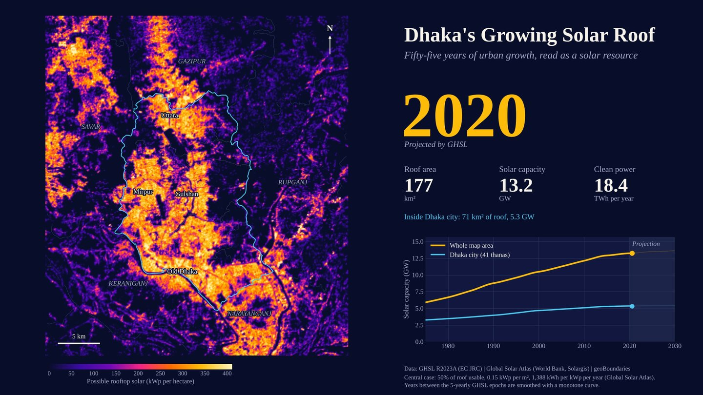
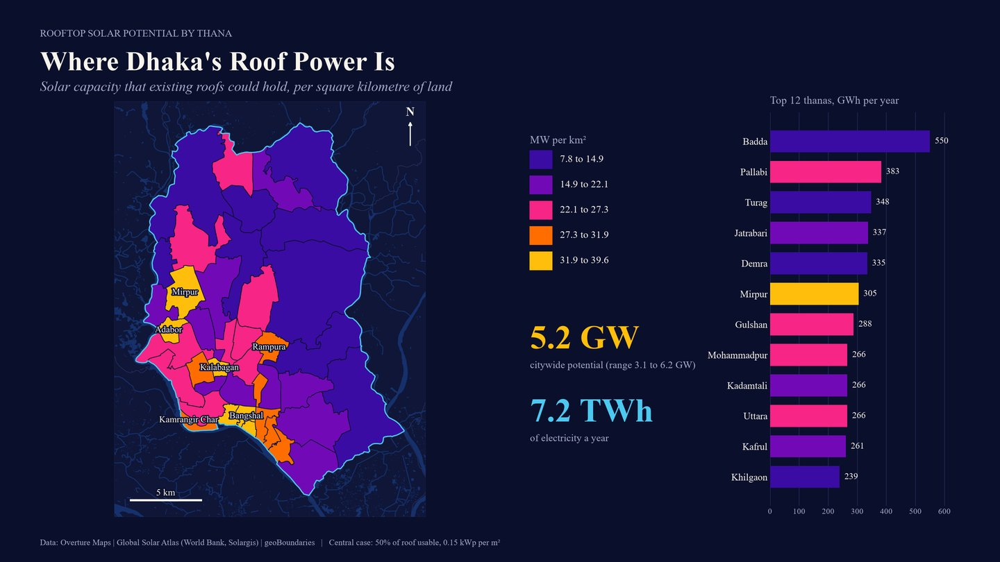
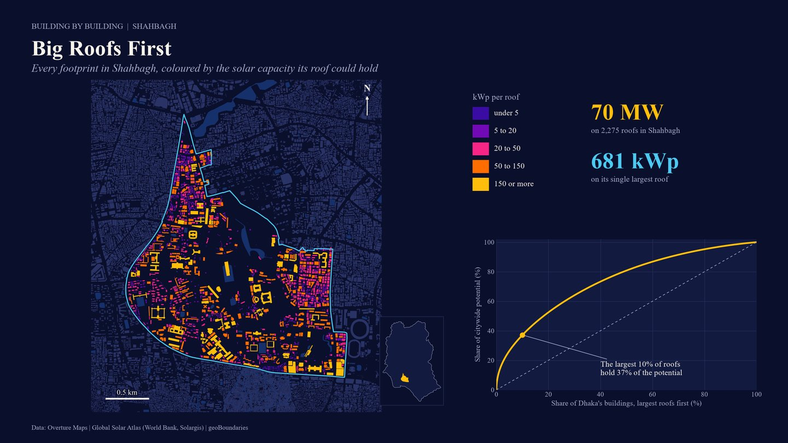

# Dhaka's Growing Solar Roof

How much solar power could Dhaka's existing roofs hold, and how has that rooftop area grown since 1975? This repository holds the analysis behind my entry to Map Competition 2026 (CERS), theme "Mapping Bangladesh for a Sustainable Future".



Interactive map: https://sajid-300.github.io/dhaka-solar-roof/

## Findings

The 41 thanas of Dhaka city (about 301 km²) contain 527,342 buildings with 68.9 km² of roof, about 23% of the city's land. If half of that roof carried panels, it could hold about 5.2 GW of solar (3.1 to 6.2 GW with 30% to 60% of each roof usable) and generate about 7.2 TWh a year.

The potential is concentrated. Ranked by size, the largest 10% of roofs hold 37% of the city's total. Shahbagh, with its university halls and hospitals, has the largest average roof; its 2,275 buildings could hold about 70 MW.

Badda, Pallabi and Turag have the most potential in total. The densest old neighbourhoods (Bangshal, Kalabagan, Adabor, Chak Bazar, Mirpur) have the most per km². Per resident, rooftop solar ranges from about 250 kWh a year in Shah Ali to over 3,500 kWh in Biman Bandar, with a city average of 589 kWh.

Across the wider Dhaka area, roof area grew from about 78 km² in 1975 to 176 km² in 2020. Inside the city it rose from 43 to 71 km² and has levelled off, so most new building is now on the fringe (Savar, Gazipur, Keraniganj, Narayanganj).

| Where the potential is | Building by building |
|---|---|
|  |  |

## Method

1. Building footprints from Overture Maps are clipped to the 41 thanas. Footprints under 20 m² are removed.
2. Usable roof is taken as 50% of each footprint, to allow for water tanks, stair rooms, shade and access. The range uses 30% and 60%.
3. Installed capacity is 0.15 kWp per usable m².
4. Yearly generation is capacity times the Global Solar Atlas PV output at each building (about 1,385 kWh per kWp in Dhaka).
5. Thana totals are joined to WorldPop 2020 population. A bivariate map compares crowding (people per km²) with rooftop solar (MW per km²), each split into thirds.
6. For change over time, GHSL built-up surface (one map every five years, 1975 to 2030) is converted with the same factors. Years between epochs are filled with a monotone cubic (PCHIP) curve for the time-lapse.

This is a technical potential. It does not account for roof strength, ownership or shading from taller buildings, and the GHSL layers for 2025 and 2030 are projections.

## Data

| Data | Source | Licence |
|---|---|---|
| Built-up surface 1975 to 2030 | GHS-BUILT-S R2023A, European Commission JRC (Pesaresi and Politis, 2023) | CC BY 4.0 |
| Building footprints, water | Overture Maps Foundation (OpenStreetMap, Microsoft and Google footprints) | ODbL / CDLA-Permissive 2.0 |
| PV output | Global Solar Atlas 2.0, World Bank Group, ESMAP, Solargis | CC BY 4.0 |
| Population 2020 | WorldPop, constrained, UN-adjusted | CC BY 4.0 |
| Thana boundaries | geoBoundaries, Bangladesh ADM3 (Runfola et al., 2020) | CC BY 4.0 |

Only the thana boundaries are stored here. The other datasets are downloaded by the scripts.

## Reproducing the results

Python 3.11 or newer.

```
git clone https://github.com/Sajid-300/dhaka-solar-roof.git
cd dhaka-solar-roof
python -m venv .venv
.venv\Scripts\activate            # Windows; on macOS or Linux: source .venv/bin/activate
pip install -r requirements.txt
python run_all.py
```

`run_all.py` runs the numbered scripts in order and writes everything to `output/`. The GHSL tiles for Dhaka (tile R7_C28) can also be downloaded by hand from the JRC site into `data/ghsl/`.

| Script | Output |
|---|---|
| `00_check_setup.py` | Checks packages, fonts and data |
| `01_download_data.py` | Downloads buildings, water, solar and population data; crops GHSL to Dhaka |
| `02_rooftop_solar.py` | Per-building and per-thana potential (`rooftop_solar.gpkg`, `thana_summary.csv`, `key_findings.txt`) |
| `03_timelapse.py` | 1975 to 2030 time-lapse video and comparison stills |
| `04_static_maps.py` | Three map boards and a PDF |
| `05_arcgis_pro_setup.py` | Run inside ArcGIS Pro: styles the results and saves a map package (`.mpkx`) |

Assumptions, colours and fonts are set in `common.py`.

## Licence

Code is released under the MIT licence. Each dataset keeps its own licence, listed above.

## Author

Sheikh Sajidul Islam, Department of Civil and Environmental Engineering, Islamic University of Technology

The code was written with help from Claude (Anthropic).
